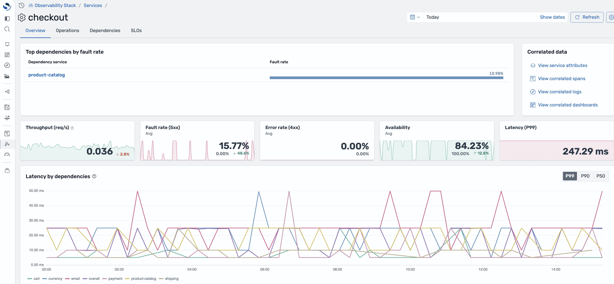
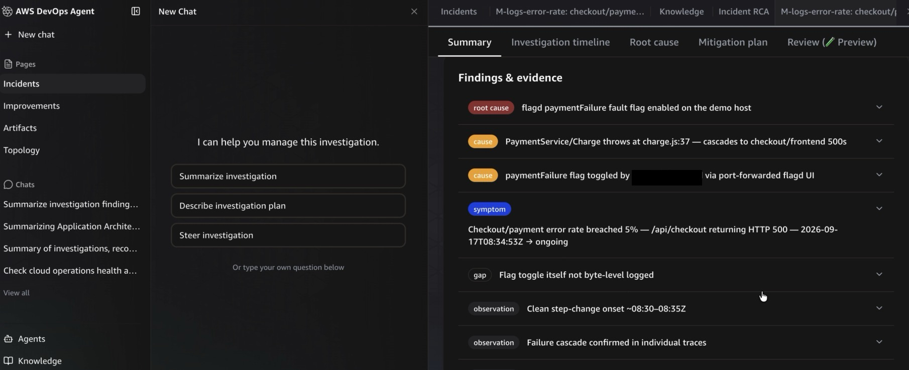

# Autonomous Monitoring using Amazon OpenSearch Service and AWS DevOps Agent

[](https://github.com/aws-samples/sample-aws-opensearch-devops-agent/actions/workflows/ci.yml)

Turn an Amazon OpenSearch Service observability stack into a self-driving incident-response loop. Amazon OpenSearch Service and Amazon Managed Service for Prometheus detect the incident, a secure webhook bridge hands it to **AWS DevOps Agent**, and the agent pulls evidence on demand from an OpenSearch MCP (Model Context Protocol) server to perform root-cause analysis and recommend remediation, with no human opening a dashboard.

> Sample code for demonstration and learning. Review the [Security](#security) and [Cost](#cost) sections before deploying into any account.

## What it looks like



*Amazon OpenSearch Service observability: the `checkout` service view (fault rate, availability, latency, and the per-dependency breakdown) that the detection monitors watch for anomalies.*



*AWS DevOps Agent autonomously investigating the resulting incident: it identifies the root cause (a `paymentFailure` fault flag enabled on the demo host), the contributing causes, and the supporting evidence pulled from the telemetry, with no human opening a dashboard.*

## Start here

Follow the **[Quick Start Guide](docs/quick-start-guide.md)**, a copy-paste checklist from clone to a working autonomous investigation (~60-90 min).

## Architecture


1. **Amazon EC2** runs the OpenTelemetry demo workloads and a local **OpenTelemetry Collector**.
2. The Collector exports logs and traces (SigV4) to **Amazon OpenSearch Ingestion** and metrics to **Amazon Managed Service for Prometheus**.
3. Amazon OpenSearch Ingestion (Data Prepper) writes logs, traces, and a service map into **Amazon OpenSearch Service**.
4. **Amazon OpenSearch Service** alerting monitors and **Amazon Managed Service for Prometheus** rules evaluate the telemetry and, on breach, publish to **Amazon SNS**.
5. An **AWS Lambda** signal bridge translates the message into the DevOps Agent incident schema, signs it with HMAC-SHA256, and POSTs it to the **AWS DevOps Agent** webhook.
6. **AWS DevOps Agent** investigates, calling the OpenSearch MCP server on **Amazon ECS on AWS Fargate** over an `AWS::DevOpsAgent::PrivateConnection` to gather logs, traces, service map, and PPL evidence, then returns RCA and remediation guidance.

Source for the diagram: [`docs/images/architecture.svg`](docs/images/architecture.svg) (regenerate with `python3 docs/images/gen-architecture.py`) and the Mermaid version at [`docs/images/architecture.mmd`](docs/images/architecture.mmd). Full component detail, data model, and decision records are in [docs/architecture.md](docs/architecture.md).

## Key features

- **No human in the loop.** OpenSearch and Prometheus alerts trigger the AWS DevOps Agent automatically.
- **Secure by design.** Alerts are signed (HMAC-SHA256) before reaching the agent, and nothing is exposed to inbound traffic.
- **Evidence on demand.** The agent queries logs, traces, and the service map through an OpenSearch MCP server while it investigates.
- **VPC-private.** The OpenSearch domain, Prometheus workspace, and MCP server stay inside your VPC.
- **Reproducible incidents.** Inject faults into the demo apps to trigger investigations on demand.
- **Infrastructure as code.** AWS CDK (TypeScript), with tests.

## Prerequisites

- An AWS account with Amazon OpenSearch Service, Amazon OpenSearch Ingestion, Amazon Managed Service for Prometheus, Amazon ECS on AWS Fargate, AWS Lambda, Amazon SNS, and **AWS DevOps Agent** available in your Region (for example, `us-east-1`).
- AWS DevOps Agent enabled, with a **generic webhook** integration created (gives you a webhook URL and an HMAC signing secret).
- Node.js 18+ and AWS CDK v2 (`npm install -g aws-cdk`).
- The AWS CLI configured for the target account.

All account-specific values (ARNs, endpoints, the webhook URL and HMAC secret, instance ids) are supplied as CDK context / environment parameters or AWS Secrets Manager entries, none are hard-coded.

## Deployment

See the **[Quick Start Guide](docs/quick-start-guide.md)** for the full walkthrough and [prerequisites-and-deployment.md](docs/prerequisites-and-deployment.md) for the complete input reference. In summary:

```bash
# 1. Deploy the observability platform (Part 1) from the upstream OpenSearch project
#    into a VPC: https://observability.opensearch.org/docs/deploy/aws/
#    See observability-stack/README.md for the coordinates Part 2 needs.

# 2. Build the OpenSearch MCP image in-account with AWS CodeBuild (no local Docker)
cd devops-agent-integration && npm install
bash mcp-servers/tls/generate.sh          # internal TLS cert (git-ignored; read at synth)
cdk deploy DevOpsAgent-Build --require-approval never
aws codebuild start-build --project-name devops-agent-mcp-build   # wait for SUCCEEDED

# 3. Store the DevOps Agent webhook secret in AWS Secrets Manager
aws secretsmanager create-secret \
  --name devops-agent/webhook-hmac \
  --secret-string "<YOUR_WEBHOOK_HMAC_SECRET>"

# 4. Deploy detection + agent integration (supply ALL obs-stack coordinates)
cdk deploy --all \
  -c obsVpcId=... -c obsSubnetIds=... -c obsSecurityGroupId=... \
  -c opensearchEndpoint=... -c domainArn=... \
  -c ampWorkspaceId=... -c ampEndpoint=... -c ampWorkspaceArn=... \
  -c fgacMasterRoleArn=... \
  -c devopsAgentWebhookUrl="<YOUR_WEBHOOK_URL>" \
  -c assignPublicIpForFargate=true \   # public-subnet quickstart; omit for private (needs NAT/VPC endpoints)
  --require-approval never

# 5. Install monitors/rules + the OpenSearch->SNS role, then verify the loop (read-only)
bash ./scenarios/verify.sh
```

Export `CDK_DEFAULT_ACCOUNT` and `CDK_DEFAULT_REGION` for your target account/Region before deploying. The CDK app splits into **Build** (Amazon ECR + AWS CodeBuild for the arm64 MCP image), **Shared** (networking/IAM), **FargateMcp** (the OpenSearch MCP server on Amazon ECS on AWS Fargate), **SignalBridge** (Amazon SNS + AWS Lambda), and **Integration** (AWS DevOps Agent Service / Association / PrivateConnection / Asset), so you can deploy incrementally.

## Running the demo

Reproduce incidents deterministically; full catalog in [docs/demo-scenarios.md](docs/demo-scenarios.md).

```bash
# OpenTelemetry Astronomy Shop: induce a payment failure
# (trips the log error-rate and Amazon Managed Service for Prometheus PromQL monitors)
./scenarios/induce-flag.sh          # FLAG=paymentFailure VARIANT=100%
./scenarios/reset-flag.sh

# GenAI travel-planner: drive weather-agent latency + errors (trips the two GenAI monitors)
curl -s -X POST http://<fault-panel>:8085/config \
  -H 'content-type: application/json' -d '{"preset":"chaos"}'
curl -s -X POST http://<fault-panel>:8085/config \
  -H 'content-type: application/json' -d '{"preset":"all_clean"}'
```

Within ~1-5 minutes the monitor breaches, the signal bridge delivers the incident to AWS DevOps Agent, and an investigation begins. Watch delivery in the AWS Lambda logs (`"event":"delivered","httpStatus":200`).

## Detection monitors

| Monitor | Signal | Fires when | Enabled by default |
|---|---|---|---|
| `M-logs-error-rate` | Amazon OpenSearch Service logs | payment/checkout WARN+ log error rate ≥ 5% | yes |
| `M-trace-latency-slo` | Amazon OpenSearch Service traces | purchase-path services p95 > 250 ms | yes |
| `M-servicemap-anomaly` | Amazon OpenSearch Service traces | per-service error rate from spans ≥ 5% | yes |
| `M-amp-promql` | Amazon Managed Service for Prometheus | checkout 5xx ratio > 20% (PromQL rule) | yes |
| `M-travelagent-error-rate` | Amazon OpenSearch Service traces (GenAI) | travel-planner/weather/events agent error rate ≥ 10% | **no** |
| `M-travelagent-latency-slo` | Amazon OpenSearch Service traces (GenAI) | weather-agent slow-call (>5 s) ratio ≥ 20% | **no** |

The four ecommerce (OpenTelemetry Astronomy Shop) monitors fire only on an injected fault. The two GenAI travel-planner monitors ship **disabled** because their baseline can breach on its own; enable them only if you want the GenAI scenario. Each monitor publishes to the shared Amazon SNS channel and carries a `runbook://` reference the agent resolves during investigation. See [Cost](#cost) for throttling and how investigations are billed.

## Cost

Indicative only; actual cost depends on Region, retention, and traffic. Standing resources:

- **Amazon OpenSearch Service** domain, the dominant cost; sized by instance type/count and EBS.
- **Amazon OpenSearch Ingestion**: per OCU-hour, floored at the configured minimum (e.g. 1 OCU).
- **Amazon Managed Service for Prometheus**: per-sample ingestion + query.
- **Amazon ECS on AWS Fargate** (2 MCP tasks) + internal Network Load Balancers: small always-on cost.
- **AWS Lambda / Amazon SNS / AWS Secrets Manager**: negligible at demo volumes.

**AWS DevOps Agent is the main variable cost:** each monitor breach delivered to the webhook starts a billed investigation. The defaults keep this in check: the GenAI weather-agent monitors ship disabled (they can breach on their own baseline), the ecommerce monitors fire only on an injected fault, and every enabled monitor is throttled to one notification per hour.

**When you finish, stop the investigations or they keep costing you.** While a fault is active and its monitor is enabled, a new billed investigation starts every 60 minutes, indefinitely. Either run [Cleanup](#cleanup) (best, also stops the standing hourly costs), or turn the fault off (`./scenarios/reset-flag.sh`) **and** disable the monitor that fired (set `"enabled": false` and re-register, or toggle it off in OpenSearch Dashboards under **Alerting → Monitors**). To stop delivery for every monitor at once, remove the signal-bridge Lambda's `devops-agent-alerts` SNS subscription or revoke the webhook. Count delivered investigations with `filter event="delivered" | stats count() by monitorId` over `/aws/lambda/devops-agent-signal-bridge`.

Use AWS Cost Explorer / AWS Cost Anomaly Detection and tear the stack down when idle.

## Cleanup

Tear everything down when you are done. This is the surest way to stop both the hourly standing costs and any further AWS DevOps Agent investigations.

**Part 2 (this repo)** is a CDK/CloudFormation app, so it destroys cleanly:

```bash
cd devops-agent-integration && cdk destroy --all
aws secretsmanager delete-secret --secret-id devops-agent/webhook-hmac --force-delete-without-recovery --region <region>
```

**Part 1 (the observability-stack)** was created by the upstream CLI installer, not by this repo, so `cdk destroy` here does not touch it. Tear it down with the installer's own `destroy`, then delete the domain and AMP workspace it leaves behind (they are preserved as "shared" and are the dominant cost):

```bash
npx @opensearch-project/observability-stack destroy --pipeline-name obs-stack-<id> --region <region>
# then manually: delete the OpenSearch Service domain and the Amazon Managed Service for Prometheus workspace
```

See the [Quick Start cleanup step](docs/quick-start-guide.md#11-clean-up) for the full resource list. If you leave the stack running instead, follow the "stop the investigations" note under [Cost](#cost) so a monitor does not keep firing hourly.

## Security

- TLS 1.2+ everywhere; the Amazon OpenSearch Service domain enforces HTTPS with fine-grained access control (FGAC) and IAM principals.
- The webhook uses **HMAC-SHA256** with replay protection; the secret lives in **AWS Secrets Manager**, never in code.
- The MCP server runs VPC-private behind an internal TLS Network Load Balancer, reached via `AWS::DevOpsAgent::PrivateConnection`; no inbound path into the VPC.
- IAM roles are least-privilege with explicit resource ARNs (no `Action: "*"` / `Resource: "*"` for data paths).
- Sample code: review and harden (retention, AWS KMS, network, quotas) before any non-demo use.

See [SECURITY.md](SECURITY.md), [docs/security-hardening.md](docs/security-hardening.md), and the [threat model](threat-modeling/README.md). Report vulnerabilities via the [AWS vulnerability reporting page](https://aws.amazon.com/security/vulnerability-reporting/); do not open a public issue.

## Contributing

Contributions are welcome. Please read [CONTRIBUTING.md](CONTRIBUTING.md).

## License

MIT-0. See [LICENSE](LICENSE). Third-party components are listed in [THIRD-PARTY-LICENSES.txt](THIRD-PARTY-LICENSES.txt); see also [NOTICE](NOTICE).
