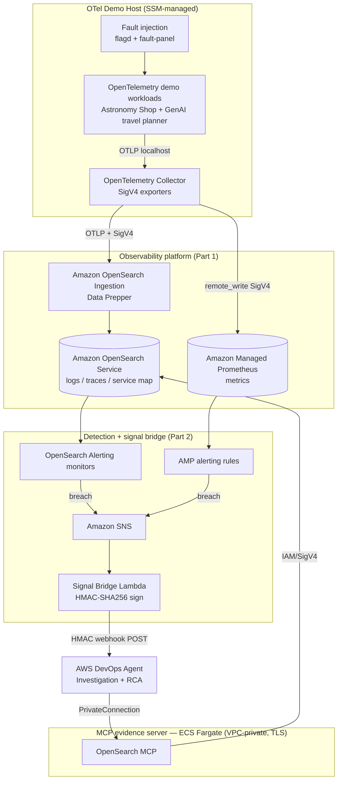

# Autonomous Monitoring using Amazon OpenSearch Service and AWS DevOps Agent

[](https://github.com/aws-samples/sample-aws-opensearch-devops-agent/actions/workflows/ci.yml)

An end-to-end sample that turns an Amazon OpenSearch Service observability stack into an **autonomous incident-response loop**: telemetry is detected by OpenSearch and Amazon Managed Service for Prometheus (AMP) alerting, incidents are pushed to **AWS DevOps Agent** through a secure webhook bridge, and the agent gathers deep evidence on demand from purpose-built **MCP (Model Context Protocol) servers** to perform root-cause analysis and recommend remediation.

> This repository is sample code intended for demonstration and learning. It is **not** production-ready as-is — review the [Security](#security) and [Cost](#cost-assessment) sections before deploying into any account.

## 🚀 Start here

**New here? Follow the [Quick Start Guide](docs/quick-start-guide.md)** — a linear, copy-paste checklist that takes you from clone to a working autonomous investigation (~60–90 min). Everything below is reference detail.

## Table of Contents
- [Introduction](#introduction)
- [Key Features](#key-features)
- [Architecture](#architecture)
- [How It Works](#how-it-works)
- [Repository Structure](#repository-structure)
- [Prerequisites](#prerequisites)
- [Deployment](#deployment)
- [Running the Demo](#running-the-demo)
- [Detection Monitors](#detection-monitors)
- [Cost Assessment](#cost-assessment)
- [Cleanup](#cleanup)
- [Security](#security)
- [Contributing](#contributing)
- [License](#license)

## Introduction

Modern observability stacks are excellent at *storing* logs, traces, and metrics — but a human still has to notice an alert, pull the relevant evidence from several tools, correlate it, and decide what to do. This sample closes that loop.

It deploys a complete AWS-managed observability platform (OpenTelemetry → Amazon OpenSearch Ingestion → Amazon OpenSearch Service + Amazon Managed Service for Prometheus) and connects it to **AWS DevOps Agent**, so that when telemetry crosses a threshold, an investigation is triggered automatically. The agent then queries the same telemetry back through MCP servers to explain *why* the incident happened and *what* to do about it — without a human opening a single dashboard.

A bundled OpenTelemetry demo application (the [OpenTelemetry Astronomy Shop](https://github.com/open-telemetry/opentelemetry-demo) plus a multi-agent GenAI "travel planner") provides realistic, fault-injectable workloads so you can reproduce incidents on demand.

## Key Features

- **Autonomous detection → investigation loop** — OpenSearch Alerting and AMP alerting rules detect incidents and trigger AWS DevOps Agent investigations with no human in the path.
- **Secure webhook signal bridge** — Alerts converge on Amazon SNS and are translated by a Lambda that HMAC-SHA256-signs each payload before POSTing to the DevOps Agent generic webhook (replay-protected, no inbound path into the VPC).
- **On-demand evidence via MCP** — The AWS/OpenSearch-maintained `opensearch-mcp-server-py` MCP server (logs, traces, service-map, PPL) lets the agent pull rich, correlated evidence during an investigation. Metrics from Amazon Managed Prometheus feed the detection/alerting path.
- **VPC-private by design** — The OpenSearch MCP server runs on Amazon ECS Fargate behind an internal TLS Network Load Balancer and is reached through `AWS::DevOpsAgent::PrivateConnection`; the OpenSearch domain and AMP workspace are never exposed publicly.
- **Realistic, fault-injectable workloads** — Toggle faults in the OpenTelemetry demo (via `flagd`) and the GenAI travel-planner (via a fault-injection panel) to reproduce incidents deterministically.
- **Six curated detection monitors** — Log error-rate, trace-latency SLO, service-map anomaly, AMP PromQL, and two GenAI-agent monitors, each grounded in real telemetry thresholds.
- **Infrastructure as code** — Everything is AWS CDK (TypeScript), split into composable stacks, with property-based tests (`fast-check`).

## Architecture



> The diagram above renders inline on GitHub. A standalone source is at
> [`docs/images/architecture.mmd`](docs/images/architecture.mmd); export a PNG with
> `mmdc -i docs/images/architecture.mmd -o docs/images/architecture.png`.

At a high level:

1. The **OpenTelemetry demo workload** on an SSM-managed EC2 host emits OTLP telemetry to a local **OpenTelemetry Collector**.
2. The Collector exports logs and traces (SigV4) to an **Amazon OpenSearch Ingestion (OSIS)** pipeline and metrics to **Amazon Managed Service for Prometheus (AMP)**.
3. OSIS (Data Prepper) transforms and writes logs, traces, and a service map into **Amazon OpenSearch Service**.
4. **OpenSearch Alerting** monitors and **AMP alerting rules** evaluate the telemetry and, on breach, publish to an **Amazon SNS** topic.
5. A **Signal Bridge Lambda** translates the SNS message into the DevOps Agent incident schema, HMAC-signs it, and POSTs it to the **AWS DevOps Agent** webhook.
6. During its investigation, the agent calls the **OpenSearch MCP server** over a private connection to gather evidence (logs, traces, service map, PPL), then produces RCA and remediation guidance following a lightweight **runbook**. (Metrics in AMP drive detection; the agent corroborates metric alerts from OpenSearch logs and spans.)

See [docs/architecture.md](docs/architecture.md) for the full component diagram, data model, and decision records.

## How It Works

```
 flagd / fault-panel        OTel Collector          OSIS (Data Prepper)        Amazon OpenSearch Service
  (inject a fault)  ──▶  (SigV4 OTLP export)  ──▶  (transform + route)  ──▶  (logs / traces / service map)
                                    │                                                     │
                                    └──────────────▶ Amazon Managed Prometheus (metrics)  │
                                                                                          ▼
                                                                          OpenSearch Alerting monitors
                                                                          + AMP alerting rules
                                                                                          │  (breach)
                                                                                          ▼
                        AWS DevOps Agent   ◀── HMAC webhook ── Signal Bridge Lambda ◀── Amazon SNS
                                │
                                └──▶ OpenSearch MCP server  (logs / traces / service-map / PPL)   ── ECS Fargate (private TLS)
```

## Repository Structure

```
autonomous-monitoring-opensearch-devops-agent/
├── README.md                     # this file
├── CHANGELOG.md
├── CONTRIBUTING.md
├── CODE_OF_CONDUCT.md
├── SECURITY.md
├── LICENSE                       # MIT-0
├── NOTICE
├── THIRD-PARTY-LICENSES.txt
├── threat-modeling/              # lightweight threat model
├── docs/                         # deep-dive documentation
│   ├── quick-start-guide.md      # ← linear, follow-along deployment checklist
│   ├── architecture.md
│   ├── prerequisites-and-deployment.md
│   ├── demo-scenarios.md
│   ├── security-hardening.md
│   └── images/
├── observability-stack/          # Part 1: the AWS-managed observability platform (CDK)
│   ├── bin/ lib/ custom-resources/
│   └── ...
└── devops-agent-integration/     # Part 2: detection + autonomous agent (CDK)
    ├── bin/app.ts                # stack composition + feature flags
    ├── lib/
    │   ├── stacks/               # Shared, FargateMcp, SignalBridge, Integration
    │   ├── agent/                # DevOps Agent Service / Association / PrivateConnection / Asset
    │   ├── detection/            # monitor + AMP rule provisioning
    │   ├── signal-bridge/        # SNS → HMAC webhook Lambda
    │   ├── runbook/              # runbook asset packaging
    │   └── iam/                  # least-privilege roles
    ├── agent-config/agent.ts     # DevOps Agent configuration
    ├── mcp-servers/              # opensearch/ + tls/ (image built in-account via CodeBuild)
    ├── monitors/                 # OpenSearch Alerting monitors + amp/ rules
    ├── runbooks/                 # agent-runbook.md (INCIDENT_RCA guidance)
    ├── scenarios/                # induce/reset-flag.sh, register-from-host.sh, verify.sh
    └── test/                     # unit + property-based tests
```

## Prerequisites

- An AWS account with access to Amazon OpenSearch Service, Amazon OpenSearch Ingestion, Amazon Managed Service for Prometheus, Amazon ECS Fargate, AWS Lambda, Amazon SNS, and **AWS DevOps Agent** in your target Region (for example, `us-east-1`).
- **AWS DevOps Agent** enabled in the account, with a **generic webhook** integration created (you will receive a webhook URL and an HMAC signing secret to configure — see [deployment docs](docs/prerequisites-and-deployment.md)).
- Node.js 18+ and the AWS CDK v2 CLI (`npm install -g aws-cdk`).
- A container build capability for the MCP server images (Docker, or an EC2/CodeBuild builder — the images are `arm64`).
- The AWS CLI configured with credentials for the target account (`aws configure` or a named profile).

> All account-specific values (account id, ARNs, domain endpoints, the webhook URL and HMAC secret, EC2 instance ids) are supplied as **CDK context / environment parameters or AWS Secrets Manager entries** — none are hard-coded in this sample.

## Deployment

Follow the linear **[Quick Start Guide](docs/quick-start-guide.md)** for the full step-by-step, or [prerequisites-and-deployment.md](docs/prerequisites-and-deployment.md) for the complete input reference. In summary:

```bash
# 1. Deploy the observability platform (Part 1) from the upstream OpenSearch project:
#    https://observability.opensearch.org/docs/deploy/aws/  (deploy into a VPC)
#    See observability-stack/README.md for the coordinates Part 2 needs.

# 2. Build the OpenSearch MCP image in-account (no local Docker) via CodeBuild
cd ../devops-agent-integration && npm install
bash mcp-servers/tls/generate.sh          # internal TLS cert (git-ignored; read at synth)
cdk deploy DevOpsAgent-Build --require-approval never
aws codebuild start-build --project-name devops-agent-mcp-build   # wait for SUCCEEDED

# 3. Store the DevOps Agent webhook secret (never commit this)
aws secretsmanager create-secret \
  --name devops-agent/webhook-hmac \
  --secret-string "<YOUR_WEBHOOK_HMAC_SECRET>"

# 4. Deploy detection + agent integration
#    Supply ALL obs-stack coordinates (see the full guide) — the placeholder
#    defaults let `cdk synth` pass but will mis-target on deploy.
cdk deploy --all \
  -c obsVpcId=... -c obsSubnetIds=... -c obsSecurityGroupId=... \
  -c opensearchEndpoint=... -c domainArn=... \
  -c ampWorkspaceId=... -c ampEndpoint=... -c ampWorkspaceArn=... \
  -c fgacMasterRoleArn=... \
  -c devopsAgentWebhookUrl="<YOUR_WEBHOOK_URL>" \
  -c assignPublicIpForFargate=true \   # public-subnet quickstart; omit for private (secure-by-default, needs NAT/VPC endpoints)
  --require-approval never

# 5. Register detection + notification role, then verify the loop (read-only)
#    (register-from-host.sh installs the monitors/FGAC/AMP rules + the OpenSearch→SNS role)
bash ./scenarios/verify.sh
```

> Before deploying, export `CDK_DEFAULT_ACCOUNT` and `CDK_DEFAULT_REGION` for your
> target account/Region (no code edit needed). See [docs/prerequisites-and-deployment.md](docs/prerequisites-and-deployment.md)
> for the full input table and discovery commands.

The CDK app is split into stacks so you can deploy incrementally: **Build** (ECR + CodeBuild for the arm64 MCP image), **Shared** (networking/IAM), **FargateMcp** (the OpenSearch MCP evidence server on ECS Fargate), **SignalBridge** (SNS + Lambda), and **Integration** (DevOps Agent AgentSpace / Service / Association / PrivateConnection / Asset).

## Running the Demo

The bundled workloads let you reproduce incidents deterministically. See [docs/demo-scenarios.md](docs/demo-scenarios.md) for the full catalog.

**OpenTelemetry Astronomy Shop (via `flagd`):**
```bash
# Induce a payment failure — trips the log error-rate and AMP PromQL monitors
./scenarios/induce-flag.sh          # FLAG=paymentFailure VARIANT=100%
# Reset
./scenarios/reset-flag.sh
```

**GenAI travel-planner (via the fault-injection panel):**
```bash
# Drive weather-agent latency + errors — trips the two GenAI-agent monitors
curl -s -X POST http://<fault-panel>:8085/config \
  -H 'content-type: application/json' \
  -d '{"preset":"chaos"}'
# Return to healthy
curl -s -X POST http://<fault-panel>:8085/config \
  -H 'content-type: application/json' -d '{"preset":"all_clean"}'
```

Within ~1–5 minutes the relevant monitor breaches, the Signal Bridge delivers the incident to AWS DevOps Agent, and an investigation begins. Watch delivery in the Signal Bridge Lambda logs (`"event":"delivered","httpStatus":200`).

## Detection Monitors

| Monitor | Signal | Fires when |
|---|---|---|
| `M-logs-error-rate` | OpenSearch logs | payment/checkout WARN+ log error rate ≥ 5% |
| `M-trace-latency-slo` | OpenSearch traces | purchase-path services p95 > 250 ms |
| `M-servicemap-anomaly` | OpenSearch traces | per-service error rate derived from spans ≥ 5% |
| `M-amp-promql` | AMP metrics | checkout 5xx ratio > 20% (PromQL rule) |
| `M-travelagent-error-rate` | OpenSearch traces (GenAI) | travel-planner/weather/events agent error rate ≥ 10% |
| `M-travelagent-latency-slo` | OpenSearch traces (GenAI) | weather-agent slow-call (>5 s) ratio ≥ 20% |

Each monitor publishes to the shared SNS notification channel and carries a `runbook://` reference the agent resolves during investigation. Thresholds are grounded in observed baseline telemetry (for example, GenAI services use a slow-call ratio rather than a raw p95, because their baseline latency is naturally high and spiky).

## Cost Assessment

Indicative only — actual cost depends on Region, retention, and traffic. Representative standing costs (Sydney, at time of writing):

- **Amazon OpenSearch Service domain** — the dominant cost; sized by instance type/count and EBS.
- **Amazon OpenSearch Ingestion (OSIS)** — billed per OCU-hour; floors at the configured minimum (e.g. 1 OCU).
- **Amazon Managed Service for Prometheus** — per-sample ingestion + query.
- **ECS Fargate (2 MCP tasks) + internal NLBs** — small standing cost for the always-on evidence servers.
- **Lambda / SNS / Secrets Manager** — negligible at demo volumes.
- **Optional S3 zero-ETL direct query** — pay-per-query managed Spark (`DirectQueryOCU`); **avoid `auto_refresh` acceleration indexes unless you need them**, as they run continuous refresh jobs that accrue cost 24/7.

Use AWS Cost Explorer / Cost Anomaly Detection and tear the stack down when not in use (see [Cleanup](#cleanup)).

## Cleanup

```bash
cd devops-agent-integration && cdk destroy --all
cd ../observability-stack && cdk destroy --all
# Then remove any manually created items: the webhook secret, any S3 log-lake buckets,
# and any OpenSearch direct-query acceleration indexes (DROP + VACUUM) if you created them.
```

## Security

- All transport is TLS 1.2+; the OpenSearch domain enforces HTTPS and uses fine-grained access control (FGAC) with IAM-based principals.
- The webhook is authenticated with **HMAC-SHA256** and replay protection; the secret is stored in AWS Secrets Manager, never in code.
- MCP servers run VPC-private behind internal TLS NLBs and are reached via `AWS::DevOpsAgent::PrivateConnection`; there is **no inbound path into the VPC**.
- IAM roles are least-privilege with explicit resource ARNs (no `Action: "*"` / `Resource: "*"` for data paths).
- This is sample code — review and harden (retention, KMS, network, quotas) before any non-demo use.

See [SECURITY.md](SECURITY.md) and [docs/security-hardening.md](docs/security-hardening.md) for the secure-by-default posture, the cdk-nag findings and dispositions, and hardening steps; a lightweight threat model is in [threat-modeling/](threat-modeling/README.md). To report a vulnerability, use the [AWS vulnerability reporting page](https://aws.amazon.com/security/vulnerability-reporting/) — do not open a public issue.

## Contributing

Contributions are welcome! Please read [CONTRIBUTING.md](CONTRIBUTING.md) first.

## License

This sample code is made available under the **MIT-0** license. See the [LICENSE](LICENSE) file. Third-party components and their licenses are listed in [THIRD-PARTY-LICENSES.txt](THIRD-PARTY-LICENSES.txt); see also [NOTICE](NOTICE).
