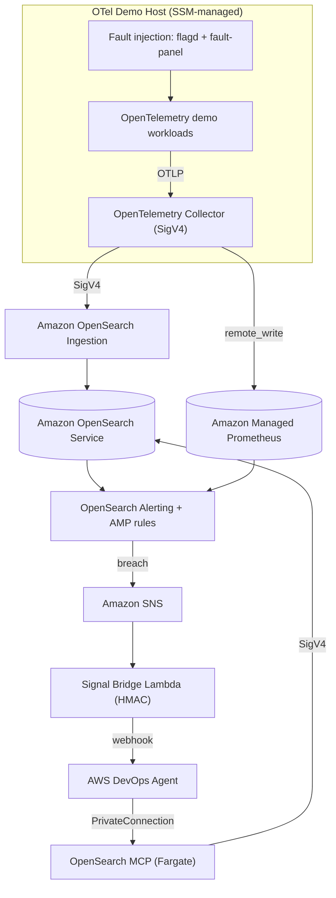

# Architecture

This sample has two composable parts:

1. **Observability platform** — an AWS-managed OpenTelemetry pipeline that stores logs and traces in Amazon OpenSearch Service and metrics in Amazon Managed Service for Prometheus (AMP).
2. **Autonomous incident response** — detection monitors, a secure webhook signal bridge, and MCP evidence servers that connect the platform to AWS DevOps Agent.

(Source: [`images/architecture.mmd`](images/architecture.mmd).)

## Component overview

| Concern | Service / component |
|---|---|
| Telemetry generation | OpenTelemetry demo workloads (Astronomy Shop + GenAI travel planner) on an SSM-managed EC2 host |
| Collection / export | OpenTelemetry Collector (SigV4 to OSIS and AMP) |
| Ingest / transform | Amazon OpenSearch Ingestion (OSIS / Data Prepper) |
| Logs & traces store | Amazon OpenSearch Service (VPC-private, FGAC, TLS) |
| Metrics store | Amazon Managed Service for Prometheus (AMP) |
| Detection | OpenSearch Alerting monitors + AMP alerting rules |
| Signal delivery | Amazon SNS → Signal Bridge Lambda (HMAC-SHA256) → AWS DevOps Agent webhook |
| Evidence gathering | OpenSearch MCP server on Amazon ECS Fargate, via `AWS::DevOpsAgent::PrivateConnection` |
| Guidance | Runbook asset (INCIDENT_RCA) attached to the agent |

## Data flow

1. A fault is induced in a workload (feature flag or fault panel).
2. The OTel Collector exports logs/traces to OSIS and metrics to AMP over SigV4.
3. OSIS transforms OTLP and writes to OpenSearch indices (logs, trace spans, service map).
4. A monitor or AMP rule crosses its threshold and publishes to Amazon SNS.
5. The Signal Bridge Lambda maps the alert to the DevOps Agent incident schema, signs it (HMAC-SHA256 over `"<timestamp>:<payload>"`, headers `x-amzn-event-signature` / `x-amzn-event-timestamp`), and POSTs it to the webhook.
6. AWS DevOps Agent starts an investigation and calls the **OpenSearch MCP** server to gather evidence — `ListIndexTool`, `SearchIndexTool`, `IndexMappingTool`, `GetShardsTool`, `PPLQueryTool` (IAM/SigV4 to the domain). (Metrics in AMP drive detection/alerting; the agent corroborates metric-based alerts from OpenSearch logs and spans.)
7. The agent performs RCA and recommends/participates in remediation, following the runbook.

## Signal-bridge pattern (why a webhook, not a direct connector)

AWS DevOps Agent has no native Amazon OpenSearch Service connector. Of the supported integration patterns, a **generic webhook** gives the lowest signal-delivery latency (event-driven push: monitor → SNS → Lambda → agent, all sub-minute) with strong security (HMAC signing, replay protection, TLS, no inbound path into the VPC). The OpenSearch MCP server is the complementary *evidence-gathering* channel invoked during the investigation.

## MCP hosting decision (Fargate vs. Bedrock AgentCore)

The OpenSearch MCP server runs on **Amazon ECS Fargate** behind an internal TLS Network Load Balancer, registered with the agent through `AWS::DevOpsAgent::PrivateConnection`. Rationale:

- `PrivateConnection` consumes a raw TLS network endpoint in the VPC — a Fargate task behind an internal NLB maps directly onto that contract.
- Full control of the container transport model (running the maintained server natively over streamable-HTTP).
- The server is a pure evidence proxy (SigV4 to OpenSearch); it does not use an agent runtime's model-invocation, memory, or identity features.

Amazon Bedrock AgentCore Runtime (VPC mode) is a viable alternative host — it removes the NLB/DNS/cert plumbing at the cost of conforming to its runtime contract — and is documented as the alternative in the design.

## Security posture

- TLS 1.2+ everywhere; OpenSearch enforces HTTPS with FGAC (IAM principals, no local master password).
- Webhook HMAC secret in AWS Secrets Manager; no static keys in code or config.
- MCP servers VPC-private; no inbound path into the VPC.
- Least-privilege IAM with explicit resource ARNs and Region conditions.
